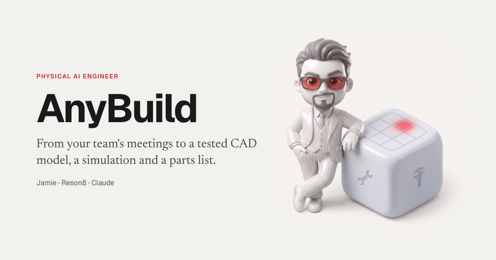
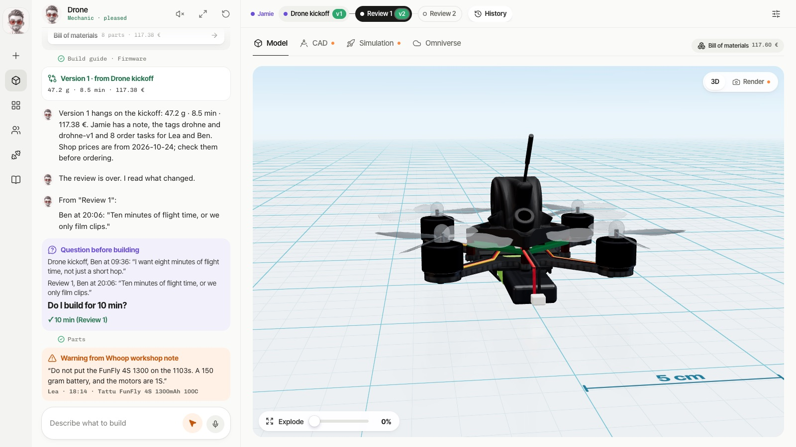
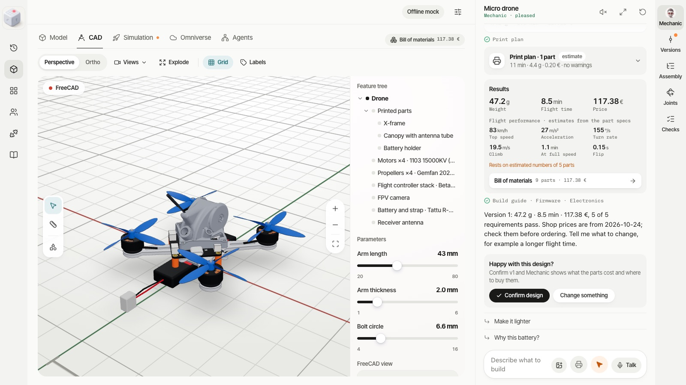
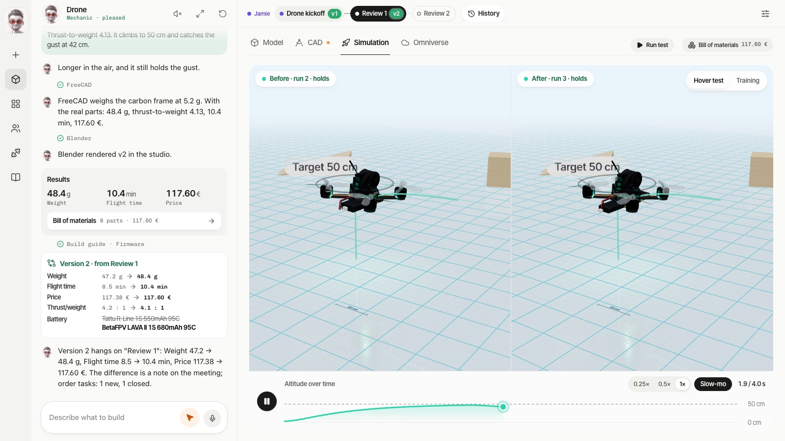
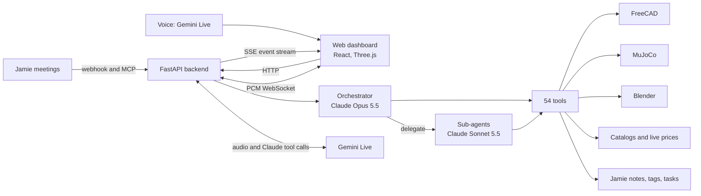

# AnyBuild



**An engineering agent that develops physical products from your team's meetings.**

AnyBuild listens to how a team talks about a product, in recorded meetings, in the chat or by voice, and turns it into a checked design.
Claude plans the work like a lead engineer with a small team of sub-agents and drives real engineering software through tool use: FreeCAD builds the parts, MuJoCo tests them, Blender renders them, and a bill of materials prices every orderable part.
Every requirement links back to the sentence in the meeting that asked for it, contradictions between meetings become questions before anything is built, and each new design version is written back to the meeting it came from.
It targets diverse physical products, from a phone stand to a plant-watering robot; the micro FPV drone is the worked example of our stage demo.

- **Live app:** https://anybuild-demo.vercel.app (the real app on our live backend; the access code is shared with the jury separately).
- **Built at:** {Tech: Europe} Agentic AI Hack Berlin, 2026-10-24.
- **Partner technology:** Anthropic Claude, Jamie, Reson8 (see [Partner technology](#partner-technology)).
- **Documentation:** [Architecture](docs/ARCHITECTURE.md), [API](docs/API.md), [Agent tools](docs/TOOLS.md), [Frameworks](docs/FRAMEWORKS.md), [Event contract](docs/events.md).



| CAD tab: FreeCAD assembly, feature tree and live parameters | Simulation tab: MuJoCo hover test before and after a fix |
| --- | --- |
|  |  |

## What it does

- **Any product from a description, a sketch or a meeting.** Type or say what you need, upload a photo of a hand sketch, start from a reference build, remix a community project, or let a Jamie meeting webhook start the build.
- **Spec with traceable requirements.** Claude writes a full product spec; every requirement names the check that judges it, its limit, and the quote, speaker and time it came from.
- **Real CAD.** Claude writes FreeCAD Python for every printed part; FreeCAD builds it visibly in the open window or headless in a sandbox, with STEP, STL, GLB and a live feature tree and parameter sliders.
- **Real parts.** Bought parts come from curated catalogs with shop links and checked prices, or live shop prices through Claude web search; estimates are marked as estimates.
- **Engineering checks and physics.** Mass, cost, size, tip-over, deflection, torque, runtime, power, thermal and roll-over checks, plus MuJoCo push, drop, hover and grip tests replayed in 3D.
- **Fix loop.** When a check fails, Claude changes a dimension or swaps a part, rebuilds and reruns every check, and says why.
- **Meeting memory with Jamie.** Warnings from earlier meetings surface before a part is chosen, contradictions become multiple-choice questions, each version is attached to its meeting with a diff note, and order tasks with assignees land in Jamie.
- **Talk to Mechanic.** One button: press **Talk** and Mechanic greets you, then you just speak, and **End** turns him off; Gemini Live (`gemini-3.8-live`, voice Fenrir) is the whole voice agent: it listens, transcribes and speaks as Mechanic, with barge-in, while Claude handles engineering.
  Mechanic never narrates on his own: he answers you, plus one short line when a build finishes, and without Gemini Live he answers in text.
  [Setup and measured latency](docs/GEMINI_LIVE.md).
- **Orchestrator and sub-agents.** Claude Opus 5.5 plans and reviews; Claude Sonnet 5.5 sub-agents write CAD scripts in parallel, pick parts, run checks and price the bill of materials, each visible as its own card with tokens and cost.
- **Controller training in the browser.** 1,024 MuJoCo simulations tune the drone's or gripper's controller, and a 50-world stress test reports robustness; optional NVIDIA Isaac Sim and Isaac Lab runs on a GPU host.
- **Deliverables.** Studio render, bill of materials (CSV and order list per shop), step-by-step build guide, Betaflight or Arduino firmware with wiring table, and one ZIP with everything.
- **Library and community.** Reference builds of real products, saved projects, and a community feed to publish and remix builds.
- **Works offline.** Without API keys, a scripted mock runs the same tools and events, so every flow can be demonstrated on a laptop.

## How it works



1. A request arrives from the chat, a voice turn, a sketch upload or a Jamie webhook.
2. Claude writes the spec, and `spec.py` validates it until it is complete.
3. CAD sub-agents write one FreeCAD script per printed part, in parallel; FreeCAD builds them.
4. The parts agent picks the bought parts, the assembly is computed, and the analysis agent runs every check and the MuJoCo test.
5. On a failure the orchestrator changes the design and everything reruns.
6. Blender renders the result, the pricing agent builds the bill of materials, and the version is written back to Jamie.
7. Every step is an event on one Server-Sent Events stream, which the dashboard renders live.

The details are in [docs/ARCHITECTURE.md](docs/ARCHITECTURE.md); every tool is described in [docs/TOOLS.md](docs/TOOLS.md).

### For reviewers: where to look

Every backend module starts with a docstring that says what it does, where it sits in the pipeline and why it is built that way.
A good reading order:

| Question | Start here |
| --- | --- |
| How does one request become a checked product? | [One request through the code](docs/ARCHITECTURE.md#one-request-through-the-code), then `agent/src/pai_agent/orchestrator.py` |
| How does Claude call the tools, and how do sub-agents work? | `orchestrator._lead_loop`, `agents.py` (`ROLES`, `run_subagent`, `delegate`) |
| Where are the tools, and what does every call go through? | `agent/src/pai_agent/tools/registry.py` (`SCHEMAS`, `call_tool`), [docs/TOOLS.md](docs/TOOLS.md) |
| How is a spec validated and pass or fail decided? | `spec.py` (`validate_spec`), `requirements.py`, `tools/checks.py`, `analysis.py`, `rigid_sim.py` |
| How is generated CAD code kept safe? | `cad_script.py` (`check_script`, `run_script`), `tools/cad_part.py` |
| How does the voice agent hand work to Claude? | `gemini_live.py` (`execute`), `web/src/lib/geminiLive.ts`, [docs/GEMINI_LIVE.md](docs/GEMINI_LIVE.md) |
| How do Jamie meetings drive versions? | `tools/jamie.py`, `jamie_client.py`, `meetings.py`, `versions.py` |
| How does the dashboard stay in sync? | `bus.py`, `web/src/events/source.ts`, `web/src/events/store.ts`, [docs/events.md](docs/events.md) |
| Why these design choices? | [Design decisions](docs/ARCHITECTURE.md#design-decisions) |
| What runs without keys? | [Mock mode and fallbacks](docs/ARCHITECTURE.md#mock-mode-and-fallbacks) |

## Partner technology

### Anthropic Claude

Claude is the engineer.
The orchestrator runs on Claude Opus 5.5 with adaptive thinking and a configurable effort level, and it drives the whole bench through 54 tools with the Messages API tool-use loop (`agent/src/pai_agent/orchestrator.py`).
It delegates bounded jobs to Claude Sonnet 5.5 sub-agents that see only the tools their job needs (`agent/src/pai_agent/agents.py`).
Claude writes the FreeCAD Python for every generated part and repairs it from FreeCAD's error messages, reads hand sketches with vision, and finds live shop prices with server-side web search.
Claude Haiku 5.5 writes the learning-mode explanations, using only numbers the tools produced.

### Jamie

Jamie is the team's memory and AnyBuild's sensory backbone.
AnyBuild talks to the Jamie MCP server over Streamable HTTP (`agent/src/pai_agent/jamie_client.py`) with `list_meetings`, `get_meeting`, `get_meeting_transcript`, `search_meetings`, `upsert_template`, `create_tasks`, `update_tasks`, `create_tag` and `add_tag_to_meetings`.
It creates the summary templates "Hardware-Anforderungen" and "Drohnen-Review", reads requirements with quote, speaker and timestamp, searches earlier meetings for warnings about a part, and detects contradictions between meetings.
When a meeting ends, Jamie's webhook starts a build; the finished version is attached to the meeting with a diff note and tags, and order tasks with assignees and due dates are created in Jamie and ticked when a part is ordered.
Without a Jamie token, the same calls answer from local fixture meetings and write to a local outbox, so the demo never stops.

### Reson8

Reson8 powers push-to-talk dictation.
The browser streams microphone audio to Reson8 with a short-lived token the backend vends (`POST /api/voice/token`), so the API key never reaches the browser, and a phrase list biases recognition toward engineering vocabulary such as Twiglet, Caddx, 1103, KV and MuJoCo.
Turn on **Push-to-talk** in Settings (for the current page; every load starts with the Talk button), hold the mic or the space bar, and the turn goes to the agent as text over Reson8's Realtime endpoint; Mechanic answers in text.
The browser's Web Speech recognition is the fallback without a Reson8 key.
The voice conversation (**Talk**) does not use Reson8: Gemini Live hears and transcribes it itself.

### Also used

Google Gemini Live provides Mechanic's only voice, native realtime audio through Vertex AI or AI Studio; [configuration and protocol](docs/GEMINI_LIVE.md).
FreeCAD, Blender, MuJoCo and NVIDIA Isaac Sim and Isaac Lab are the engineering tools Claude operates.
The full stack with versions and licenses is in [docs/FRAMEWORKS.md](docs/FRAMEWORKS.md).

## Quick start

### Prerequisites

- macOS or Linux, with [uv](https://docs.astral.sh/uv/) (it installs Python 3.12 on first run) and Node.js 20 or newer.
- Optional: [FreeCAD 1.1](https://www.freecad.org/) and [Blender](https://www.blender.org/) in `/Applications` for real CAD and renders; without them CadQuery and a recorded still stand in.
- Optional: Rust for the Mac app.
- Optional API keys in `agent/.env` (see [Configuration](#configuration)); without any key the scripted mock runs.

### Backend

```bash
cd agent && uv run physical-ai-agent
```

The backend listens on `http://127.0.0.1:8100`.

### Web dashboard

```bash
cd web && npm install && npm run dev
```

Open `http://127.0.0.1:5180`.
Vite proxies `/api` and `/files` to the backend; set `BACKEND_URL` to point it elsewhere.
If the port needs to be explicit: `npm run dev -- --port 5180 --host 127.0.0.1`.

### Mac app

```bash
cd web && npm install
cd ../desktop && npm install && npm run dev
```

`npm run build` in `desktop/` bundles `AnyBuild.app` (see [desktop/README.md](desktop/README.md)).

### Try it

Type into the chat, for example:

```text
Design a phone stand for my desk that holds my phone for video calls. It must not tip when I tap the screen and the parts should cost under 6 euros.
```

```text
Design a robot gripper for our arm that picks up a 200 g soda can, 66 mm wide. Keep it under 150 g and 30 €.
```

Or start from a reference build in the Library, upload a sketch, or replay the two drone meetings through the Jamie webhook:

```bash
curl -s -X POST http://127.0.0.1:8100/api/webhooks/jamie \
  -H 'content-type: application/json' \
  --data @agent/data/webhooks/meeting-ended.json
curl -s -X POST http://127.0.0.1:8100/api/webhooks/jamie \
  -H 'content-type: application/json' \
  --data @agent/data/webhooks/review-ended.json
```

The kickoff builds drone version 1 (47.2 g, 8.5 min, 117.38 EUR); the review asks which flight time counts, swaps the battery and builds version 2 (48.4 g, 10.4 min, 117.60 EUR).
`curl -s -X POST http://127.0.0.1:8100/api/reset -H 'content-type: application/json'` starts over.

### Mock mode

Without `ANTHROPIC_API_KEY`, the backend runs scripted stories through the same tools that Claude calls: the drone kickoff and review, the phone stand (a tip-over failure fixed by a wider base), the robot gripper (an SG90 servo that drops the can, replaced by an MG996R) and the reference builds.
The top bar says whether Claude is live or the mock runs.
`PAI_FORCE_MOCK=1` forces the mock even with a key.

### Real FreeCAD in the open window (optional)

With the [freecad-mcp](https://github.com/neka-nat/freecad-mcp) add-on, `cad_frame` builds the drone visibly in the FreeCAD window, stage by stage.
One-time setup on FreeCAD 1.1:

```bash
git clone https://github.com/neka-nat/freecad-mcp.git
mkdir -p "$HOME/Library/Application Support/FreeCAD/v1-1/Mod"
cp -R freecad-mcp/addon/FreeCADMCP "$HOME/Library/Application Support/FreeCAD/v1-1/Mod/FreeCADMCP"
```

Then open the `MCP Addon` workbench in FreeCAD and select `Toggle Auto Start`.
`FREECAD_GUI=launch` opens FreeCAD automatically; `FREECAD_GUI=off` forces headless runs.

## Configuration

Put settings in `agent/.env` or the shell; shell variables win.
Never commit `.env` files or keys.
Every variable is optional.

### Models and services

| Variable | Purpose |
| --- | --- |
| `ANTHROPIC_API_KEY` | Enables Claude; empty runs the mock. Also enables live shop prices. |
| `ANTHROPIC_MODEL` | Orchestrator model when `PAI_ORCHESTRATOR_MODEL` is unset (default `claude-opus-5-5`). |
| `PAI_ORCHESTRATOR_MODEL`, `PAI_ORCHESTRATOR_EFFORT` | Orchestrator model and effort (`low` to `max`, default `high`). |
| `PAI_SUBAGENT_MODEL`, `PAI_SUBAGENT_EFFORT` | Sub-agent model (default `claude-sonnet-5-5`) and effort (default `medium`). |
| `PAI_DELEGATION` | `0` lets the orchestrator do the sub-agents' jobs itself. |
| `ANTHROPIC_VOICE_MODEL` | Model for the learning-mode explanations (default `claude-haiku-5-5`). |
| `PAI_FORCE_MOCK` | `1` forces the mock even with a key. |
| `JAMIE_MCP_TOKEN`, `JAMIE_MCP_URL` | Live Jamie MCP access (default URL `https://mcp.meetjamie.ai/mcp`); empty uses fixtures and the outbox. |
| `JAMIE_WEBHOOK_SECRET` | Required in `X-Jamie-Secret` or `?secret=` on the webhook when set. |
| `GEMINI_LIVE_PROVIDER`, `GOOGLE_CLOUD_PROJECT`, `GOOGLE_CLOUD_LOCATION`, `GEMINI_API_KEY`, `GEMINI_LIVE_MODEL`, `GEMINI_LIVE_VOICE` | Mechanic's only voice, Gemini Live (default model `gemini-3.8-live`, voice `Fenrir`): Vertex with gcloud user OAuth or AI Studio with a server-only key; empty keeps Mechanic silent with text replies; see [voice setup](docs/GEMINI_LIVE.md). |
| `RESON8_API_KEY`, `RESON8_LANGUAGE`, `RESON8_CUSTOM_MODEL_ID` | Reson8 speech-to-text (default language `en`); empty uses browser speech recognition. |

### Engineering tools and runtime

| Variable | Purpose |
| --- | --- |
| `FREECAD_GUI` | `auto` (build in an open window), `launch` (start FreeCAD), `off` (headless only). |
| `FREECAD_MCP_URL` | freecad-mcp RPC server (default `http://127.0.0.1:9875`). |
| `ISAAC_SSH_HOST`, `ISAAC_SSH_PORT`, `ISAAC_SSH_USER`, `ISAAC_SSH_KEY`, `ISAAC_TIMEOUT_S` | GPU host for Isaac Sim and Isaac Lab (`RUNPOD_SSH_*` are accepted aliases); empty uses the recorded result. |
| `PAI_ASK_TIMEOUT_S` | Seconds Mechanic waits for an answer before taking the default (default `20`). |
| `PAI_TOOL_TIMEOUT_S`, `PAI_TIMEOUT_<TOOL>`, `PAI_MODEL_TIMEOUT_S` | Time limits per tool call and per model round (see `agent/src/pai_agent/timeouts.py`). |
| `PAI_TRAIN_TIMEOUT_S`, `PAI_TRAIN_CLAIM_TIMEOUT_S`, `PAI_TRAIN_STALL_S` | Time limits for browser training jobs. |
| `PAI_SLICER` | Optional slicer executable path; `off` uses labelled estimates. |
| `PAI_CACHE` | `0` turns off reuse of identical FreeCAD and Blender results. |
| `PAI_WARM` | `0` skips warming slow imports at start. |
| `DEMO_PACE_S` | Pause between steps in seconds, for stage pacing (default `0`). |
| `PORT` | Backend port (default `8100`). |

### Public deployment

| Variable | Purpose |
| --- | --- |
| `ANYBUILD_ACCESS_CODE` | Access code for a public backend; when set, every route except `GET /api/health` needs a session from `POST /api/access`, and rate limits apply. |
| `ANYBUILD_CORS_ORIGINS` | Extra allowed browser origins, comma-separated. |
| `ANYBUILD_LIMIT_BUILDS`, `ANYBUILD_LIMIT_SPEECH`, `ANYBUILD_LIMIT_STT`, `ANYBUILD_LIMIT_CAD`, `ANYBUILD_LIMIT_EXPLAIN` | Hourly limits per session (defaults 20, 300, 60, 120, 120; each IP gets three times the per-session limit). |
| `VITE_API_BASE` | Backend URL baked into a web build (Vercel, Mac app). |
| `BACKEND_URL` | Backend the Vite dev server proxies to (default `http://localhost:8100`). |

## Public live deployment

The public web app at https://anybuild-demo.vercel.app is the real app: it talks to the live backend on the team's Mac, which runs Claude, FreeCAD, Blender, MuJoCo, Gemini Live and Reson8.
Tailscale Funnel publishes that backend over HTTPS, and an access code shared only with the team and the jury keeps strangers from spending the API credit.

On the Mac, start the backend with an access code (put real values in `agent/.env`, never in the repository):

```bash
cd agent && ANYBUILD_ACCESS_CODE=<code> uv run physical-ai-agent
```

Publish port 8100 through Tailscale Funnel; the backend is then reachable at `https://<machine>.<tailnet>.ts.net`:

```bash
tailscale funnel --bg 8100
```

Build the web app against that URL; on Vercel, set `VITE_API_BASE` as a build environment variable:

```bash
cd web && VITE_API_BASE=https://<machine>.<tailnet>.ts.net npm run build
```

On start the web app calls `GET /api/health`.
When the backend asks for a code, the app shows one field, "Enter access code", then the full app; when it does not answer, the app shows "Live backend offline, try again shortly" and retries.
The session token lasts 24 hours; changing `ANYBUILD_ACCESS_CODE` and restarting the backend signs everyone out.
Ten wrong codes from one IP within 15 minutes block that IP for the rest of the window, and builds, speech and Reson8 tokens have hourly limits, answered with HTTP 429 and a notice in the app.
All visitors share the one bench session on the Mac, as in a live demo.

Check the gate from any machine:

```bash
curl -s https://<machine>.<tailnet>.ts.net/api/health
curl -s -o /dev/null -w "%{http_code}\n" -X POST https://<machine>.<tailnet>.ts.net/api/prompt
```

The first prints `"access": "required"`, the second `401`.

## Bench results

AnyBuild Bench measures how often the agent turns a product prompt into a valid, checked product.
`agent/bench/prompts.json` holds 20 prompts (drone variants, gripper, phone stand, desk lamp, desk fan, Pi enclosure, plant-watering robot, RC car, wall hook, cable organizer and more), each with the checks that judge it: the build finished, CAD geometry, a bill of materials, a render, and the requirements that must be met (`req:mass`, `req:tip_over`, `req:deflection`, ...).
The runner sends each prompt through the real flow (orchestrator, tools, checks) on its own fresh bench, in its own process, and records pass or fail per check, retries, time, tokens and cost:

```bash
cd agent && uv run python -m bench.run --limit 8 -j 2 --timeout 900 --budget 3600   # live, needs ANTHROPIC_API_KEY
cd agent && uv run python -m bench.run --mock                                        # mock: the recorded subset
```

`-j` limits how many prompts run at once, `--timeout` stops one prompt, `--budget` skips prompts that cannot start in time, `--only id,id` picks prompts.
Results go to `agent/bench/results/live.json` or `mock.json`; open them in the app under Settings → AnyBuild Bench results (or `?benchmark`), where "Open on bench" builds a prompt again.

| Run | Prompts | Valid products | Checks passed | Cost per product |
| --- | --- | --- | --- | --- |
| Mock (no Claude, no FreeCAD) | 5 of 20 | 1 of 5 | 31 of 36 | $0 |
| Live | not run yet | | | |

The mock row is **not a result of the live agent**: it replays the recorded mock stories for the five products the mock knows, on a machine without FreeCAD, where printed parts fall back to simplified CadQuery blocks and come out too heavy.
A live run with a key is the measurement that counts.

## Testing

```bash
cd agent && uv run --with pytest pytest tests          # unit tests
cd agent && uv run python scripts/smoke_sse.py         # drone kickoff and review over SSE, mock mode, port 8101
cd agent && uv run python scripts/smoke_product.py     # any-product flow
cd agent && uv run python scripts/smoke_cad_part.py    # generated FreeCAD part, no network
cd agent && uv run python scripts/smoke_community.py   # publish and remix round trip
cd web && npm run typecheck && npm run e2e             # type check and Playwright flows
```

`E2E_LIVE=1 npm run e2e:live` runs the Playwright smoke against a backend with `ANTHROPIC_API_KEY`.

## Documentation

| Document | Contents |
| --- | --- |
| [docs/ARCHITECTURE.md](docs/ARCHITECTURE.md) | Components, one request through the code, orchestrator and sub-agents, CAD pipeline, simulation, voice loop, event stream, fallbacks, security, design decisions. |
| [docs/API.md](docs/API.md) | Every HTTP endpoint and SSE event, with auth and rate limits. |
| [docs/events.md](docs/events.md) | The authoritative wire format of every request, response and event. |
| [docs/TOOLS.md](docs/TOOLS.md) | All 54 agent tools with inputs, outputs and the software behind them. |
| [docs/GEMINI_LIVE.md](docs/GEMINI_LIVE.md) | The Gemini Live voice agent: configuration, protocol, transcripts and measured latency. |
| [docs/FRAMEWORKS.md](docs/FRAMEWORKS.md) | Frameworks, services and applications with versions and licenses. |
| [docs/omniverse.md](docs/omniverse.md) | NVIDIA Isaac Sim and Isaac Lab experiments on a GPU host. |
| [docs/PLAN.md](docs/PLAN.md) | The hackathon day plan. |
| [THIRD_PARTY_NOTICES.md](THIRD_PARTY_NOTICES.md) | Third-party models, adapted code and generated media. |

## Team

- Batuhan Caniberk ([BatuCani](https://github.com/BatuCani))
- Ansorjon Juraev ([TheWingTheWong](https://github.com/TheWingTheWong))

The project was first named Bauplan, and some package and path names still say so.

## License

AnyBuild is released under the [MIT License](LICENSE).
Third-party models and adapted code keep their own licenses, listed in [THIRD_PARTY_NOTICES.md](THIRD_PARTY_NOTICES.md).
