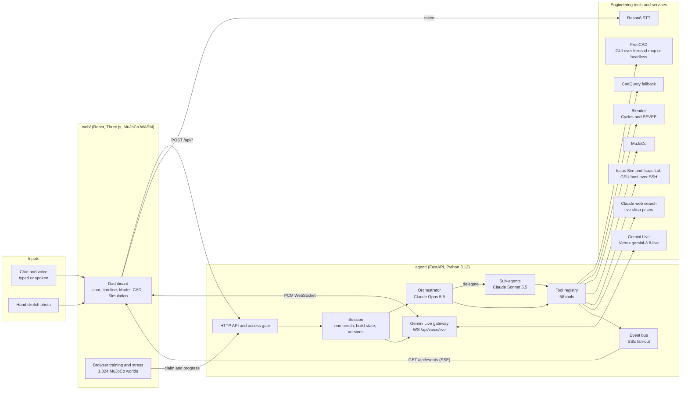
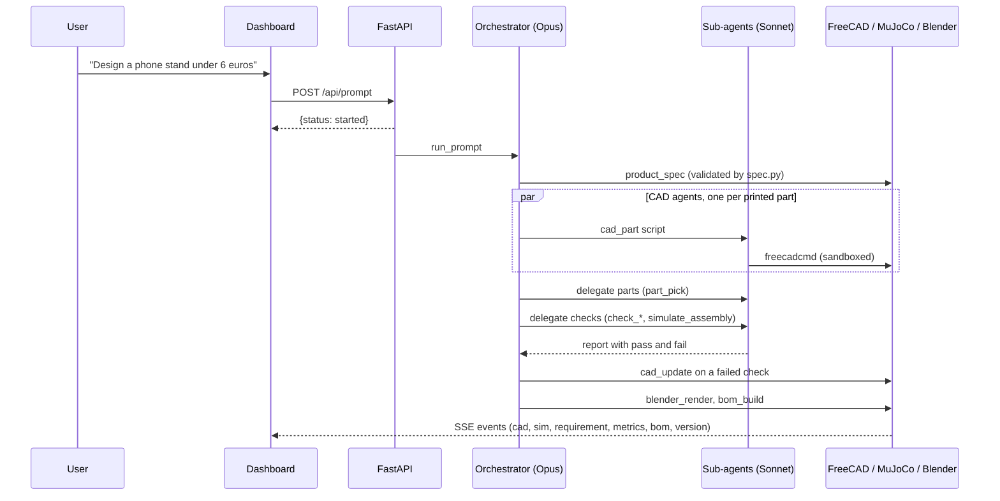
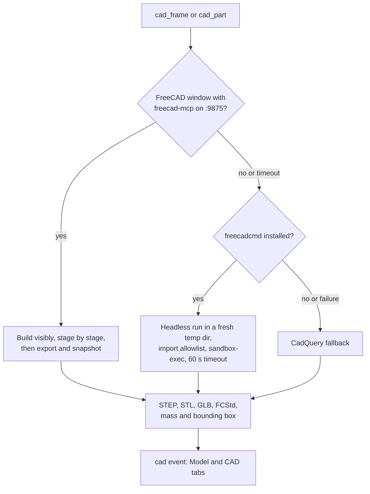

# Architecture

AnyBuild turns a typed or spoken request or a hand sketch into a checked physical product: printed parts in CAD, bought parts with prices, engineering checks, a physics test, a studio render and a bill of materials.
This document explains the components, how data flows between them, how Claude plans and delegates the work, and how the dashboard follows along over one event stream.
The wire format is specified in [events.md](events.md), every endpoint and event is indexed in [API.md](API.md), and every agent tool is described in [TOOLS.md](TOOLS.md).

## Components



| Component | Where | Role |
| --- | --- | --- |
| HTTP API | `agent/src/pai_agent/app.py` | FastAPI routes, CORS, the access gate (`access.py`), the SSE stream and static file serving. |
| Session | `agent/src/pai_agent/session.py` | The single bench: starts runs, holds the `BuildState` (`state.py`), versions (`versions.py`), open questions and order tasks, and refuses a second build while one runs. |
| Orchestrator | `agent/src/pai_agent/orchestrator.py` | The Claude tool-use loop with Mechanic's system prompt; without Claude (`provider.py`) it runs the scripted mock stories through the same tools. |
| Studio notes | `agent/src/pai_agent/notes.py`, `web/src/events/notes.ts` | What the person clicked, measured, drew on or read in the studio, as chips that go with a message; the backend adds the script lines that build a part and Mechanic reads them, markings as pictures. |
| Subscription | `agent/src/pai_agent/provider.py`, `subscription.py` | Picks the API key, the local Claude Code subscription or the mock; on the subscription every Claude call runs in Claude Code through the Claude Agent SDK, with the app's tools on an in-process MCP server and no API key in its environment. |
| Sub-agents | `agent/src/pai_agent/agents.py` | Bounded jobs on a smaller model: CAD scripts, parts, checks, pricing. |
| Tool registry | `agent/src/pai_agent/tools/registry.py` | One schema list and one dispatch for Claude and the mock, with per-tool timeouts (`timeouts.py`). |
| Event bus | `agent/src/pai_agent/bus.py` | In-memory fan-out; a late subscriber gets the backlog, then a `replayed` marker, then live events. |
| Voice | `agent/src/pai_agent/gemini_live.py`, `voice.py` | The Gemini Live gateway (Mechanic's only voice) and Reson8 token vending. |
| Engineering core | `spec.py`, `analysis.py`, `analysis_more.py`, `rigid_sim.py`, `grip_sim.py`, `assembly.py` | Spec validation, closed-form checks, MuJoCo rigid-body tests and the assembly model. |
| CAD runners | `freecad_run.py`, `cad_script.py`, `agent/freecad/` | FreeCAD in the open window over `freecad-mcp`, headless `freecadcmd` in a sandbox, CadQuery as the last fallback. |
| SolidCraft | `solidcraft.py`, `solidcraft_mjcf.py`, `agent/solidcraft/` | With `PAI_CAD_ENGINE=solidcraft`: parts and mechanisms in headless `solidcraft-cli`, their URDF, and the MJCF MuJoCo makes of it with the loops closed. |
| Rendering | `agent/blender/studio.py`, `tools/blender.py` | Headless Blender studio renders of the assembled GLB. |
| Library and community | `references.py`, `community.py`, `agent/data/references/`, `agent/data/community/` | Known reference builds, saved projects, the published feed and remixes. |
| Cache and warm-up | `cache.py`, `warm.py` | Reuse identical FreeCAD and Blender results and pre-load slow imports at start. |
| Dashboard | `web/src/` | React 19 app: the Zustand store (`events/store.ts`) folds SSE events into UI state; Three.js renders the model, CAD and simulation replays. |
| Mac app | `desktop/` | Tauri 2 window around the same dashboard. |
| GPU experiments | `runpod/`, `tools/isaac.py`, `tools/usd.py` | USD export, Isaac Sim tests and Isaac Lab training on a remote GPU host, see [omniverse.md](omniverse.md). |

## Data flow of one build

1. A request arrives as `POST /api/prompt` (typed or spoken), `POST /api/sketch` (photo), `POST /api/library/{id}/open` (reference) or `POST /api/community/{id}/remix` (remix).
2. `app_control.py` answers pure dashboard commands ("show me the CAD", "pull it apart") at once with `ui_control` calls, without a model call.
3. Everything else starts a run in the session; the HTTP call returns immediately with `status: started`.
4. The orchestrator writes one short sentence per step, then calls tools; every tool result is also published as events (`tool`, `cad`, `sim`, `requirement`, `metrics`, `bom`, and more).
5. When a check fails, the orchestrator changes a parameter with `cad_update` or swaps a part, and every check that ran before runs again.
6. The run ends with a render, a bill of materials and a version with its difference to the previous one.
7. The dashboard never polls: it renders whatever the event stream says, so a reconnecting client replays the backlog onto an empty state.



## One request through the code

This section follows one typed request, "design a phone stand under 6 euros", through the code with the function that handles each step.
Paths are relative to `agent/src/pai_agent/` unless they start with `web/`.

1. **Browser to backend.** The chat input calls the source's prompt action (`web/src/events/source.ts`), which posts `POST /api/prompt`.
   `app.py` validates the body and calls `Session.start` (`session.py`).
2. **Dashboard commands first.** `Session.start` asks `app_control.match_commands` whether the text only asks to see something ("show me the CAD"); if so it presses those controls through `tools/ui.py` and no model is called.
   If a run is already in progress, the text either answers the open question or is refused with `already_running`; two runs never share one `BuildState`.
3. **A background run.** Otherwise `Session.start` creates one `asyncio` task around `orchestrator.run_prompt` and returns `{"status": "started"}` immediately; everything after this point reaches the browser only as events.
4. **Live or offline.** `run_prompt` checks `env.claude_enabled`.
   Without a key it routes by keywords to a deterministic runner (`mock_product.py` for this request) that calls the same tools in a fixed order.
   With a key it calls `_run_claude`, which opens an `agents.AgentRun` for the orchestrator (an `agent` event the chat shows as a card) and enters `_lead_loop`.
5. **The model round.** `_lead_loop` sends Mechanic's system prompt, the tool schemas (`tools/registry.SCHEMAS`, minus the delegated ones) and the conversation to `agents.create_message` (Anthropic Messages API, adaptive thinking, the configured effort).
   Text blocks become `chat` events; every `tool_use` block goes to `tools/registry.call_tool`.
6. **The spec.** Claude's first call is `product_spec` (`tools/product.py`), which runs `spec.validate_spec`.
   A spec with problems returns all of them at once as an error result, the model fixes them and calls again; only a valid spec becomes requirement rows and the assembly skeleton.
7. **CAD.** Claude calls `cad_part` once per printed part, all in one round, and `_lead_loop` runs them concurrently.
   `tools/cad_part.cad_part` has a CAD agent write FreeCAD Python for the part (`_write_script`), `cad_script.check_script` rejects anything outside the allowed imports and file access, and `cad_script.run_script` runs it in `freecadcmd` in a fresh temporary directory (under `sandbox-exec` on macOS) with a timeout.
   `cad_script.check_geometry` compares the result with the part's envelope; on an error the message goes back to the CAD agent, up to `MAX_ATTEMPTS = 3`, then a clearly marked block stands in (`run_block`).
   A part's standard parts (`fasteners`: screws, nuts, washers, heat-set inserts) are built in CadQuery first (`pai_agent/fasteners`, SOMA's `fasteners.py` on bd_warehouse's tables) and go into the harness as STEP files: it cuts their clearance, tap, insert and trap holes, and material left where one sits fails the build like a script error.
   Every success emits a `cad` event with STEP, STL and GLB links.
8. **Bought parts, assembly, checks.** With delegation on, the orchestrator calls `delegate` (`agents.delegate`), which runs `agents.run_subagent` with the parts role and only `part_pick` available.
   `assemble` (`assembly.py`) combines meshes, masses and costs into one model with centre of mass and footprint.
   The checks role then runs `check_totals`, `check_tip_over` and `simulate_assembly` (`tools/checks.py`, math in `analysis.py`, MuJoCo in `rigid_sim.py`), and each check stores its result in `state.checks`.
9. **Pass or fail is derived, not claimed.** After every successful tool call, `call_tool` runs `requirements.refresh_requirements`, which recomputes every requirement row from `state` (`tools/checks.judge` for a generic product) and emits `requirement` and `metrics` events.
   The model never sets a row to met; it can only change the design and let the checks run again.
10. **The fix loop.** On a failed check Claude calls `cad_update` (`tools/product.py`), which rebuilds that part with the new parameter, reassembles and reruns every check that ran before (`rerun_checks`), or swaps a bought part with `part_pick`.
11. **Deliverables.** `blender_render` (`tools/blender.py`) renders the assembly, `safety_check` (`tools/safety.py`) runs right before `bom_build` (`tools/bom.py`), which emits the bill of materials with a `price_source` per line, then `print_prep` and, for products with electronics, `electronics_plan`.
    A build with an ESP32 or a Raspberry Pi Pico then gets `circuit_design` (`tools/circuit.py`): SparkBench, run headless in Node.js (`sparkbench.py`, `agent/sparkbench/bridge.ts`), wires it to real pins, checks it, runs its MicroPython in a simulator and writes the KiCad schematic.
    For every product, the drone included, `call_tool` hands a successful `bom_build` to `versions.after_tool`, which commits the build as a version with its diff to the previous one.
12. **Back in the browser.** `web/src/events/source.ts` receives every event over `GET /api/events` and `web/src/events/store.ts` folds it into state; the chat, the Model, CAD and Simulation tabs and the requirement cards re-render from that store.

The voice path joins at step 1: Gemini Live's `engineer` function (`gemini_live.execute`) calls the same `Session.start` with the spoken request, waits for the run, and reads the measured result back as speech.

## Orchestrator and sub-agents

Claude works like a lead engineer with a small team.
The orchestrator (Claude Opus 5.5 by default, effort `high`, configurable up to `max`) plans the build, writes the spec, decides the fixes and reviews every report.
It delegates bounded jobs to sub-agents on a smaller model (Claude Sonnet 5.5 by default), each with only the tools its job needs:

| Sub-agent | Tools | Job |
| --- | --- | --- |
| CAD agent | FreeCAD script writer behind `cad_part` | Writes one printed part's FreeCAD Python; several parts run side by side. |
| Parts agent | `part_pick` | Binds every bought part to a catalog entry, or an honest estimate marked as such. |
| Analysis agent | `assemble`, `check_totals`, `check_tip_over`, `check_deflection`, `check_torque`, `check_runtime`, `simulate_assembly` | Runs every check the requirements name with honest loads and reports pass or fail with numbers. |
| Pricing agent | `part_pick`, `bom_build` | Builds and prices the bill of materials and swaps estimates for catalog parts where one fits. |

With delegation on, `part_pick`, `simulate_assembly` and the `check_*` tools belong to the sub-agents and the orchestrator reaches them through the `delegate` tool (`DELEGATED` in `tools/registry.py`).
Known gap: `check_power`, `check_thermal` and `check_rollover` are in `DELEGATED` but not in the analysis agent's tool list, so with delegation on neither agent can call them; `PAI_DELEGATION=0` makes them available to the orchestrator.
Every agent streams as an `agent` event with role, model, effort, job, status, rounds, tokens and cost, and shows up as its own card in the chat.
Models, effort and delegation are set with `PAI_ORCHESTRATOR_MODEL`, `PAI_ORCHESTRATOR_EFFORT`, `PAI_SUBAGENT_MODEL`, `PAI_SUBAGENT_EFFORT` and `PAI_DELEGATION`, or at runtime from the settings button in the top bar (`/api/settings`).
A third, fast model (Claude Haiku 5.5, `ANTHROPIC_VOICE_MODEL`) only writes the learning-mode explanations, and it may only use numbers that are in the facts it was given.

### Honesty rules

The orchestrator prompt forbids claiming a pass, a price or a number that a tool did not produce.
Prices carry a `price_source` of `live`, `catalog` or `estimate`, and the dashboard marks each one.
Recorded GPU results say `source: recorded` and are never presented as a test of the current product.
A recorded Robo Use trial says `status: recorded` and whether the bench holds the design it was recorded on; when it does not, its verdict reads as an example.
When a generated CAD script fails three times, a plain block stands in and is clearly marked, so a live build never ends without geometry.

## Any product: the generic flow

AnyBuild builds whatever physical product a team describes; the drone and the robot gripper are worked examples with their own flows.
For any other product Claude drives the bench through these tools:

1. `product_spec`: Claude writes the spec (function, requirements each with the check that judges it and a limit, and every printed part, bought part and external load); `agent/src/pai_agent/spec.py` validates it and lists every problem at once until it is right.
2. `cad_part` per printed part: Claude writes the FreeCAD script, `freecadcmd` builds it headless and sandboxed, and the geometry is checked against the part's envelope; failed scripts go back to Claude with the error.
3. `part_pick` per bought part: catalog parts from `agent/data/catalogs/` (hobby electronics, motors, fans, pumps, batteries, servos, hardware, plus the drone and gripper catalogs), or an honest estimate; live shop prices plug in through `pai_agent.pricing.register_provider`.
4. `assemble`: one model with mass, cost, centre of mass, size and footprint, and warnings for parts that float.
5. Checks against the requirements: `check_totals`, `check_tip_over`, `check_deflection`, `check_torque`, `check_runtime`, `check_power`, `check_thermal`, `check_rollover`, and `simulate_assembly` (a MuJoCo push or drop test of the whole assembly, replayed with the real model in the Simulation tab).
6. On a fail Claude changes a parameter with `cad_update` (rebuild, reassemble and rerun every check) or swaps a part, and says why.
7. `blender_render` and `bom_build`, then optionally `build_guide` and `firmware`.

The math behind each check is in `agent/src/pai_agent/analysis.py`, `analysis_more.py` and `rigid_sim.py`.
The dashboard renders any product from the spec and the check results: requirement rows with the measured value, key-number cards, the assembly tree, per-part parameter sliders in the CAD tab (moving one reruns the checks without a model call), the before and after MuJoCo replay, and a bill of materials with sample, estimated and live prices marked.

### Starting points

- **From scratch:** any typed or spoken description.
- **From a sketch:** `POST /api/sketch` stores the photo, `sketch_to_spec` reads it with Claude vision (every dimension with value, unit and confidence), and the orchestrator continues with `product_spec`.
- **From a reference:** the library (`agent/data/references/`) holds known products with their real parts; loading one rebuilds it through the same tools, then the user changes it in the chat.
- **From the community:** a published project is remixed on a fresh bench with a link back to the original.

The library (`GET /api/library`) lists the micro FPV drone first and the robot gripper second, both built by their own code, then the reference builds and the projects users saved with `POST /api/library`.
Each saved or reference build is one `reference.json` with the spec, the picks and the checks, one FreeCAD script per printed part, and a studio render as thumbnail.
A reference is rebuilt and rechecked through the same tools without a key, and the user then changes it in the chat, for example "make it hold a 480 g tablet", and live Claude reworks it.
The community feed (`GET /api/community`) shows published projects with render, author, key numbers and remix count, searchable and sorted by new or popular.
Publishing shares the bench with its spec, parts, CAD files, renders and versions; a remix opens a published project on a fresh bench with a link back to the original, and publishing the remix counts toward the original's remixes.
`agent/scripts/seed_community.py` seeds the feed from the library builds with their real numbers.

## The robot gripper worked example

The second built-in product is a parametric two-finger robot gripper, chosen because it has moving parts, a real physics question (does it hold the object while the arm moves?) and a parts choice that changes the CAD.
`product_brief` turns the request into checks, `catalog_search` picks servo, pads, hardware and driver from `agent/data/catalogs/gripper.json`, `grip_calc` computes finger force and grip safety, `simulate_grip` lifts, shakes and pulls the object in MuJoCo with the template's fingers swinging on their gears, and `cad_part` builds the gripper from `agent/freecad/library/gripper.py` with the servo pocket sized for the chosen servo, then `blender_render` and `bom_build`.
The template also declares its kinematics next to its parts (the finger hinges, the gear coupling, the tool frame and collision boxes), so `pai_agent/mjcf_export.py` can write the built gripper as one MuJoCo MJCF file with the catalog servo as its actuator (`agent/scripts/export_gripper_mjcf.py`).
`anybuild-robouse/` runs that file in Robo Use's tabletop benchmark, in its own environment, and `robouse_trial` runs it from the app as an independent test of the built gripper (see [Simulation and training](#simulation-and-training)).
In the mock, the SG90 servo drops the can and the MG996R holds it; a heavier object that the MG996R cannot hold at twice its weight steps up to the DS3218.

## The drone worked example

The stage demo builds a 1S 2-inch toothpick FPV drone from a typed request, then changes it from a typed message.
It arrives at a real reference build, the toothpick from Mediocre Nerd's video "Build a Micro FPV Drone for $59": Twiglet 2" carbon frame, 1103 15000KV motors, Gemfan 2020 four-blade props, Caddx Ant camera, BetaFPV Matrix 1S 5in1 V2 AIO, canopy with battery holder, M1.4 bolts and a 1S pack.
Each is a bill-of-materials line with its mass, its shop price checked on 2026-10-24 and the product page of that exact part (`agent/data/parts.json`).
`product_brief` turns the request into requirements: every number the user typed (a budget, a flight time, a weight) becomes a requirement quoting the user's words, and hover and the printable frame are added as proposed by Mechanic.
`requirements.attribute` only attributes a requirement to the user when its quote is in what the user typed; any other limit is shown as proposed by Mechanic, never as someone's sentence.
Then `parts_search` picks every part with the requirement it serves, `physics_calc` and `simulate_drone` check the hover against a downdraft gust, `cad_frame` builds the frame in FreeCAD, `blender_render` renders it and `bom_build` prices it and commits the version.
In the offline demo the first build tries the FunFly 4S, fails the gust, swaps to the Tattu R-Line 1S 550 and builds version 1 (48.3 g, 8.2 min, 117.38 EUR for under 120 euros, 8 minutes and 50 g); "Make it fly 10 minutes." revises the flight-time requirement and swaps to the BetaFPV LAVA II 1S 680 for version 2 (49.5 g, 10.1 min, 117.60 EUR).
`ask_user` stays for decisions only the user can make, such as accepting a lower limit when a requirement cannot be met.

## CAD pipeline



- `cad_frame` builds the full drone from `agent/freecad/frame_build.py`: the Twiglet carbon X-frame (weighed by FreeCAD at carbon-plate density), 1103 motors, Gemfan 2020 props, the AIO flight controller, the canopy and camera from downloaded open models, battery, strap and antenna, each its own GLB node with PBR materials.
- `cad_part` builds any part from a description: Claude writes FreeCAD Python, the script is checked before it runs (only `FreeCAD`, `Part` and `math` imports, no file access), runs headless in a fresh temp directory without the backend's environment, and on macOS `sandbox-exec` blocks network access and writes outside that directory.
  A failed script returns to Claude with the error, up to three attempts.
- Identical inputs reuse earlier results from `agent/runs/cache/` (`PAI_CACHE=0` turns that off).
- With `PAI_CAD_ENGINE=solidcraft`, parts that move on joints go to SolidCraft instead: `solidcraft_part` runs a SolidCraft command script in `solidcraft-cli` (a library template, Claude's script written from SolidCraft's own skills, or one passed in), and `export_urdf` writes its URDF and the MJCF MuJoCo makes of it, with the loops closed, checked against SolidCraft's motion study ([agent/solidcraft/README.md](../agent/solidcraft/README.md)).
- In the open FreeCAD window, `cad_frame` builds stage by stage (frame, motors, propellers, flight controller, canopy and camera, battery and strap, antenna), exports, and captures a viewport snapshot; the chat shows each stage, and a step that does not answer within 12 seconds falls back to headless `freecadcmd`.

### Drone model and studio render

The Twiglet carbon X-frame is a unibody plate with rounded arms, motor pads and lightening slots; FreeCAD weighs it at carbon-plate density (5.2 g against the 5.3 g listing) and that mass replaces the catalog figure.
The canopy and the camera are downloaded open models of the real parts, used 1:1 from `agent/freecad/parts/` (DLQFPV's toothpick canopy, CC BY 4.0, and Youfu's Caddx Ant Lite, CC0); no openly licensed model exists of the frame, motors, props or AIO board, so those are remodeled from published dimensions (see [THIRD_PARTY_NOTICES.md](../THIRD_PARTY_NOTICES.md)).
The GLB carries real materials: a generated 2x2 twill carbon weave under a clear coat, black anodized motor bells with copper windings, clear grey polycarbonate props, a green solder-mask board with chips and passives, and black TPU for the canopy.
The build writes `frame.FCStd` (the assembly), `frame.step` and `frame.stl` (the X-frame), `drone.step` (the assembly) and `frame.glb` (one node per scene target), which the Model and CAD tabs show.
`blender_render` renders that GLB headless on a workbench scene like the reference photo of the build: a green cutting mat with a 10 mm grid, an overhead panel, a desk lamp and a rim light, path-traced in Cycles (Metal GPU when available) at 1600 x 900.
Without a GLB (the CadQuery fallback) the studio places simple parts around the frame STL in EEVEE, and without Blender the recorded still is served.
- `POST /api/cad/params` reruns the same script with new slider values without a model call, and `POST /api/cad/open` opens the current model in the FreeCAD app.

## Simulation and training

- **Closed-form checks** (`analysis.py`, `analysis_more.py`): totals, tip-over angle and push, beam deflection and stress safety, torque margin, battery runtime, power headroom, enclosure temperature and vehicle roll-over.
- **MuJoCo on the backend:** `simulate_drone` (hover with a downdraft gust), `simulate_assembly` (push or drop test of any assembly as one rigid body with the real centre of mass) and `simulate_grip` (lift, shake and a pull at twice the weight for the gripper).
- **MuJoCo in the browser:** `train_in_browser` tunes the controller across 1,024 simulations (64 candidates over 16 generations, evolution strategy) and `stress_test` flies the result in 50 randomized worlds; the backend queues the job, one dashboard tab claims it through `/api/training/*` or `/api/stress/*`, and progress returns as `training` and `stress` events.
- **NVIDIA Isaac Sim and Isaac Lab:** `product_usd` exports the assembly as USD, `isaac_test` runs wind, payload or hover experiments and `isaac_train` trains the reference Crazyflie task on a GPU host over SSH; without a host, a clearly labelled recorded result stands in.
- **Robo Use, an independent benchmark:** `robouse_trial` (`tools/robouse_trial.py`) exports the built gripper as MJCF, writes a Robo Use task from the brief and runs `robouse tasks check` (the reference solution scores 1, the no-op control 0) and, when asked, Claude Code as the policy, through the `anybuild-robouse` bridge in its own environment; the trial's video, robo requests and hand path return as one `trial` event, and without the bridge a clearly labelled recorded trial stands in.

## Voice loop

Gemini Live is Mechanic's only voice; without it Mechanic answers in text.
The backend proxies native audio through Vertex AI with gcloud user OAuth or AI Studio with a server-only key.
Gemini calls Claude for engineering and the existing app controls for navigation, and its own transcription of both sides feeds the chat and logbook; Reson8 is not part of the voice conversation.
Gemini output plays through Web Audio and drives the mascot's lip-sync.
Mechanic speaks only inside a voice conversation the person started with **Talk** in the chat input: he answers them, plus at most one short line when a build finishes, and never narrates build progress.
See [realtime voice](GEMINI_LIVE.md) for configuration, protocol, transcript ownership and measured latency.

```text
mic -16 kHz PCM-> WS /api/voice/live -> Gemini Live (gemini-3.8-live, Fenrir) -> 24 kHz PCM -> Web Audio + lip-sync
                                             +-> input and output transcription -> chat and logbook
                                             +-> engineer / control_app / product_state -> Claude and the dashboard
```

- **Listening:** Gemini Live's voice detection and transcription hear the conversation.
- **Push-to-talk dictation:** with `RESON8_API_KEY`, the browser streams 16 kHz PCM to Reson8's Realtime endpoint while the key is held, with a short-lived token from `POST /api/voice/token` and a phrase list for the domain vocabulary (`PHRASES` in `voice.py`); the API key never leaves the backend.
- **Speaking:** only Gemini Live speaks, natively, with the prebuilt voice `Fenrir` (`GEMINI_LIVE_VOICE` overrides it); chat lines, mascot bubbles and questions are never read aloud.
- **Persona:** Mechanic is self-assured and witty, may swear mildly when it fits, never at the person, and stays honest: no claimed pass, price or number that a tool did not produce.
- **Lip-sync:** `useSpeech` in `web/src/lib/speech.ts` measures the audio level every frame and drives the mascot's mouth while Mechanic speaks.
- **Barge-in:** Gemini's voice detection interrupts Mechanic the moment the person talks.
- Fallbacks: without Reson8, push-to-talk uses the browser's Web Speech recognition; without Gemini Live there is no voice conversation, and Mechanic answers typed messages in text.

## Event stream

The backend publishes every state change as one JSON object on `GET /api/events`.
Every stream starts with `reset`, then the backlog, then a `replayed` marker, then live events, with `: keepalive` comments every 15 seconds.
The web store (`web/src/events/store.ts`) folds events into UI state.
The 33 event types and their payloads are listed in [API.md](API.md#server-sent-events) and specified in [events.md](events.md#sse-events).

## Mock mode and fallbacks

Every external dependency has a fallback, so the full workflow runs on a laptop without keys:

| Missing | Fallback |
| --- | --- |
| `ANTHROPIC_API_KEY` | Scripted mock stories (`mock_story.py`, `mock_product.py`, `mock_gripper.py`, `mock_categories.py`) call the same tools with the same events. |
| `RESON8_API_KEY` | Push-to-talk uses browser Web Speech recognition; typing always works. |
| Gemini Live (`GOOGLE_CLOUD_PROJECT` with gcloud, or `GEMINI_API_KEY`) | Mechanic stays silent and shows text; the microphone still dictates. |
| FreeCAD window | Headless `freecadcmd`, then CadQuery. |
| Blender | The recorded still `agent/runs/fallback/render.png`. |
| GPU host for Isaac | A recorded, clearly labelled result. |
| Robo Use environment (`anybuild-robouse`) | The trial recorded on the gripper mock story's design (`agent/data/robouse/recorded/`), labelled as recorded, and as an example when the bench holds another design. |
| Live shop prices | Catalog sample prices with their check date, or marked estimates. |

## Security model of the public backend

The public web app on Vercel talks to the backend on the team's Mac through Tailscale Funnel.
`ANYBUILD_ACCESS_CODE` gates every route except `GET /api/health` and `POST /api/access`; sessions are bearer tokens or an `HttpOnly` cookie valid for 24 hours.
Wrong codes are rate limited per IP, and builds, speech, speech-to-text tokens, CAD recomputes and explanations have hourly limits per session and per IP.
State-changing calls without a typed body require `Content-Type: application/json`, and CORS allows only localhost, the Mac app and the Vercel deployments.
Generated CAD scripts run sandboxed as described above, and `/files/` serves only single path segments inside the session directory.

## Design decisions

The reasons behind the main choices, for a reviewer who wants to know why the code looks the way it does.

- **Real engineering tools instead of generated meshes.** A mesh from an image or text model looks right but has no dimensions to check, no mass and no editable history.
  FreeCAD produces B-rep solids with exact dimensions, a mass from volume and density, STEP files a workshop can open, and a parametric script that `cad_update` and the CAD sliders rerun with new values.
  MuJoCo gives a pass or fail from physics rather than from the model's judgement.
- **The model decides, tools compute.** Every number the dashboard shows comes from a tool result; requirement rows are recomputed from state after each call (`requirements.refresh_requirements`), and the system prompt forbids stating a number a tool did not produce.
  This makes model errors visible as failed checks instead of confident text.
- **One tool dispatch for every caller.** Claude, the sub-agents, the offline mock runners and the dashboard controls all go through `tools/registry.call_tool`.
  The offline demo therefore exercises the same CAD, simulation and pricing code as a live run, and every call gets the same timeout, `tool` events and requirement refresh.
- **Sub-agents for bounded jobs.** Writing one part's FreeCAD script, picking parts and running checks do not need the orchestrator's model or its whole context.
  Each sub-agent sees only its role's tools and a short task (`agents.ROLES`), so it is cheaper, cannot change what it was not asked to change, and several CAD agents run in parallel.
  The orchestrator keeps the spec, the fixes and the final word.
- **Validate before building, check before ordering.** `spec.validate_spec` rejects an incomplete spec with every problem at once before any CAD runs, and the orchestrator prompt runs the requirement checks and `safety_check` before `bom_build`, so parts go on an order list only after the design was tested.
- **Generated code runs sandboxed.** Claude writes FreeCAD Python, so `cad_script.py` treats it as untrusted: a static check of imports and attribute access, a fresh temporary directory, an environment without the backend's secrets, a timeout, and `sandbox-exec` on macOS.
- **Everything degrades with a label, nothing silently.** Each external dependency has a fallback (see [Mock mode and fallbacks](#mock-mode-and-fallbacks)), and each fallback says so: `price_source: estimate`, `source: recorded`, a marked placeholder block, a recorded still.
- **One event stream as the only state channel.** The backend never renders UI and the dashboard never polls; it replays the backlog onto an empty store (`bus.EventBus`, `events/store.ts`).
  A reconnecting or second client shows exactly the same bench, which is also what makes the Mac app and the public web app identical.
- **Gemini for conversation, Claude for engineering.** Gemini Live handles low-latency speech, barge-in and transcription; engineering requests go through its `engineer` function into the same Claude run as typed text, so spoken and typed requests produce the same, checked result.
- **The request as the source of requirements.** Each requirement and part choice keeps the user's words it came from, and a limit the user did not give is marked as proposed by Mechanic (`requirements.attribute`), so a design decision can be traced to the request that made it and no default replaces what was asked.

## Repository layout

| Path | Contents |
| --- | --- |
| `agent/src/pai_agent/` | Backend package: API, session, orchestrator, sub-agents, engineering core, voice. |
| `agent/src/pai_agent/tools/` | The 58 agent tools, see [TOOLS.md](TOOLS.md). |
| `agent/freecad/` | FreeCAD build scripts, the part harness, parametric library parts and downloaded part models. |
| `agent/solidcraft/` | SolidCraft's skills for the CAD agent and the library of SolidCraft designs (four-bar, two-finger gripper). |
| `agent/blender/` | The Blender studio scene script. |
| `agent/data/` | Part catalogs, reference builds, community seeds, the sample sketch. |
| `agent/scripts/` | Smoke tests, the demo recorder, profiling and seeding scripts. |
| `agent/tests/` | Pytest unit tests. |
| `web/src/` | Dashboard: `events/` (store, SSE source, types), `components/`, `views/`, `sim/` (MuJoCo WASM). |
| `web/e2e/` | Playwright end-to-end tests. |
| `desktop/` | Tauri 2 Mac app. |
| `runpod/` | Isaac Sim and Isaac Lab setup and job scripts. |
| `docs/` | This documentation. |
